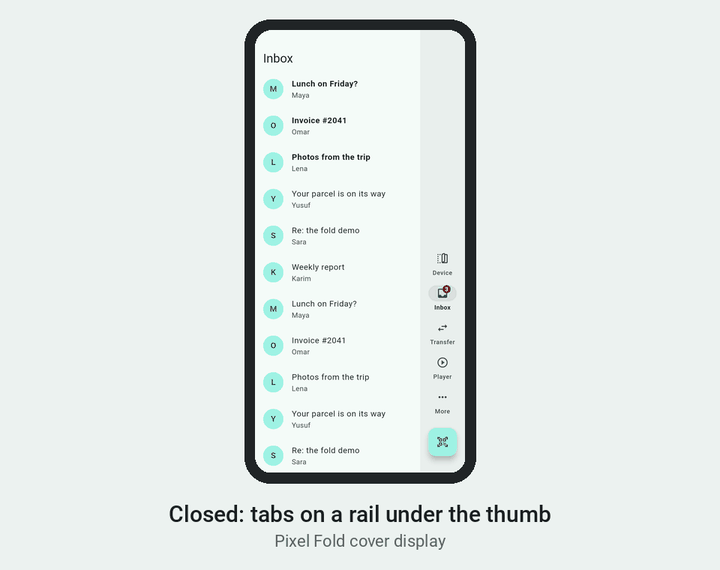

# fold_adaptive_nav

[](https://pub.dev/packages/fold_adaptive_nav)
[](https://pub.dev/packages/fold_adaptive_nav/score)
[](https://github.com/abbas-alayan25/fold_adaptive_nav/actions/workflows/ci.yml)
[](fold_adaptive_nav/LICENSE)

**Flutter navigation and layouts that know the device is a foldable** — open
or closed, half open or flat, and where its hinge is. Native detection on
Android (Jetpack WindowManager) and iOS (iPhone Duo), one widget, no device
checks in your app.

<p align="center">
  
</p>

```dart
void main() => runApp(FoldScope(child: MaterialApp(home: const Shell())));

AdaptiveNavScaffold(
  destinations: const [
    NavDestination(icon: Icons.home_outlined, label: 'Home'),
    NavDestination(icon: Icons.inbox_outlined, label: 'Inbox', badge: '3'),
    NavDestination(icon: Icons.person_outline, label: 'Profile'),
  ],
  currentIndex: tab,
  onSelect: (i) => setState(() => tab = i),
  body: pages[tab],
)
```

| | Tabs | Content |
|---|---|---|
| Phone | Floating bottom bar, or a `CupertinoTabBar` | One pane |
| Closed foldable | A rail under the thumb | One pane; flow buttons in a thumb column |
| Opened foldable | Bottom bar, or a side bar in landscape: expanded, collapsible, grouped | Panes that meet at the hinge; tabletop above and below the fold |
| Split screen | Phone layout | One pane |
| Tablet | Bottom bar, side bar or drawer | Two panes from 840 pt |

State survives every change: scroll positions, text input, the open item,
playback.

## Get started

- **[Package README](fold_adaptive_nav/README.md)** — setup, every widget, the native settings
- **[pub.dev](https://pub.dev/packages/fold_adaptive_nav)** — install, API docs, example
- **[Example app](fold_adaptive_nav/example)** — every feature, with live settings
- **[go_router example](examples/go_router_example)** — a back stack per tab, deep links
- **[Migrating from flutter_adaptive_scaffold](docs/migrating-from-flutter_adaptive_scaffold.md)** — it's discontinued; this is parameter by parameter

## Devices

| Device | Status |
|---|---|
| Pixel Fold, Pixel 10 Pro Fold | Tested on the device |
| iPhone Duo | Tested on the device |
| Android foldable emulator (Pixel Fold profile) | Tested in CI on every change |
| Galaxy Z Fold, Galaxy Z Flip, Razr, Honor, Oppo | Expected to work; [send a device report](https://github.com/abbas-alayan25/fold_adaptive_nav/issues/new?template=device_report.yml) |

## Packages

| Package | Version |
|---|---|
| [`fold_adaptive_nav`](fold_adaptive_nav) | [](https://pub.dev/packages/fold_adaptive_nav) |
| [`fold_adaptive_nav_platform_interface`](fold_adaptive_nav_platform_interface) | [](https://pub.dev/packages/fold_adaptive_nav_platform_interface) |
| [`fold_adaptive_nav_android`](fold_adaptive_nav_android) | [](https://pub.dev/packages/fold_adaptive_nav_android) |
| [`fold_adaptive_nav_ios`](fold_adaptive_nav_ios) | [](https://pub.dev/packages/fold_adaptive_nav_ios) |

Apps depend on `fold_adaptive_nav` only; it brings the others.

## Contributing

Device reports, bugs and pull requests are welcome — see
[CONTRIBUTING.md](CONTRIBUTING.md). The packages follow semantic versioning.

## License

[BSD-3-Clause](fold_adaptive_nav/LICENSE)
